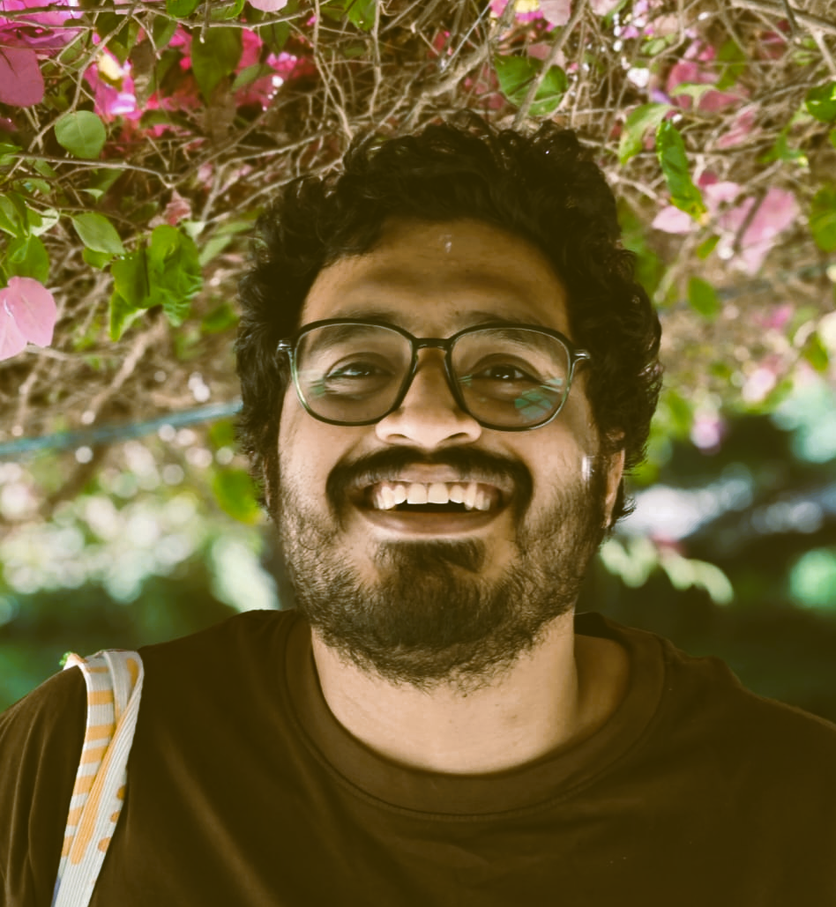

---
hide:
  - toc
  - navigation
---
<!--
CHECKLIST FOR THIS PAGE:
- [ ] Replace [YOUR NAME] with your full name (3 places)
- [ ] Replace [YOUR JOB TITLE] with your current or target role
- [ ] Replace [YOUR TAGLINE] with a short phrase describing your focus
- [ ] Rewrite the About Me paragraph with your own words
- [ ] Replace assets/images/profile.png with your actual photo (keep the filename or update it below)
- [ ] Replace assets/images/about.png with your own image (a field photo, map, or workspace shot)
- [ ] Edit the skill cards to match your actual skills (add, remove, or rename cards as needed)
- [ ] Update GitHub and LinkedIn links in the Connect section
- [ ] Add your CV PDF to docs/assets/ and update the filename in the Download CV button
-->

  
  <h1>Rajat Rao</h1>
  
<strong>Geospatial Analyst | Environment Consultant</strong>

  
<em>Exploring social and environmental complexities, one spatial curiosity at a time.</em>

 

# About

I am a geospatial analyst with a keen interest in understanding the complex relationships between people, places, and the environment. In my previous work, I managed large geospatial datasets and conducted critical analyses of India's high-altitude ecosystems. I use GIS, remote sensing, Python, and R to explore environmental patterns, investigate geographical questions, and uncover stories hidden within spatial data. I am particularly drawn to understanding landscapes, river systems, terrain, and glaciers. For me, every map is an opportunity to ask questions about a place and encourage space-based thinking in people, which I believe is an essential first step in resolving any issue.

  <iframe
      width="100%"
      height="190"
      src="https://www.youtube.com/embed/ip58-lPwOD8"
      title="About Me - YouTube Video"
      frameborder="0"
      allow="accelerometer; autoplay; clipboard-write; encrypted-media; gyroscope; picture-in-picture; web-share"
      referrerpolicy="strict-origin-when-cross-origin"
      allowfullscreen>
  </iframe>

  

      A short film I made based on my M. Sc. thesis. It spatially maps 20 years of rampant development along the IT belt in Bengaluru.
  

---

[View My Projects :material-arrow-right:](projects/index.md){ .md-button .md-button--primary }
[Download CV :material-download:](assets/rajat-CV.pdf){ .md-button }

---

## Skills

-   :material-map-search:{ .lg .middle } **GIS & Spatial Analysis**

    ---

    - QGIS, ArcGIS, TerrSet
    - Vector and raster analysis
    - Geoprocessing and spatial data integration
    - Terrain, hydrological and landscape analysis

-   :material-code-braces:{ .lg .middle } **Programming & Data Processing**

    ---

    - Python — Pandas, NumPy and PyMuPDF
    - R — terra, usdm, tidyverse, camtrapR and sf
    - Data extraction, cleaning and transformation

-   :material-satellite-variant:{ .lg .middle } **Remote Sensing & Environmental Analysis**

    ---

    - InVEST — Habitat Quality Modelling
    - DEM analysis and Landsat Image correction
    - River systems, glaciers and high-altitude ecosystems

-   :material-map-legend:{ .lg .middle } **Cartography & Data Visualisation**

    ---

    - Spatial data visualisation and thematic cartography
    - Scientific map design and layout
    - Geographical data storytelling

-   :material-file-document-edit-outline:{ .lg .middle } **Scientific Writing & Research Communication**

    ---

    - Scientific paper and technical report writing
    - Grant proposals and funding applications
    - Research synthesis and documentation
    - Scientific and environmental article writing

-   :material-clipboard-list-outline:{ .lg .middle } **Fieldwork & Geographical Surveys**
    
    ---

    - Field data collection and documentation
    - Ground-truthing and spatial verification
    - Landscape observation, assessment and survey

---

## Connect

[GitHub](https://github.com/cosmicfudge){ .md-button }
[LinkedIn](https://www.linkedin.com/in/cosmicfudge){ .md-button }
