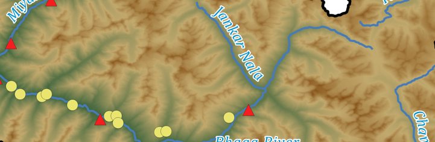
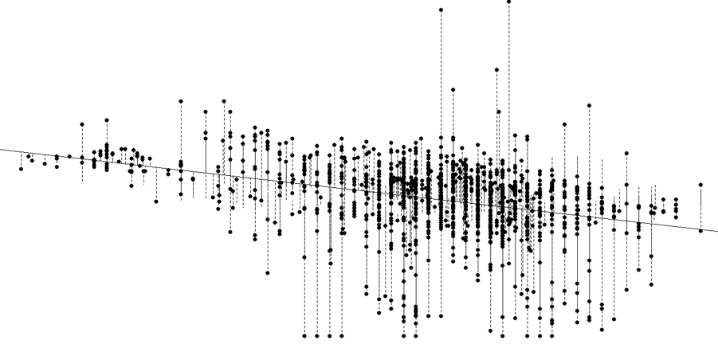
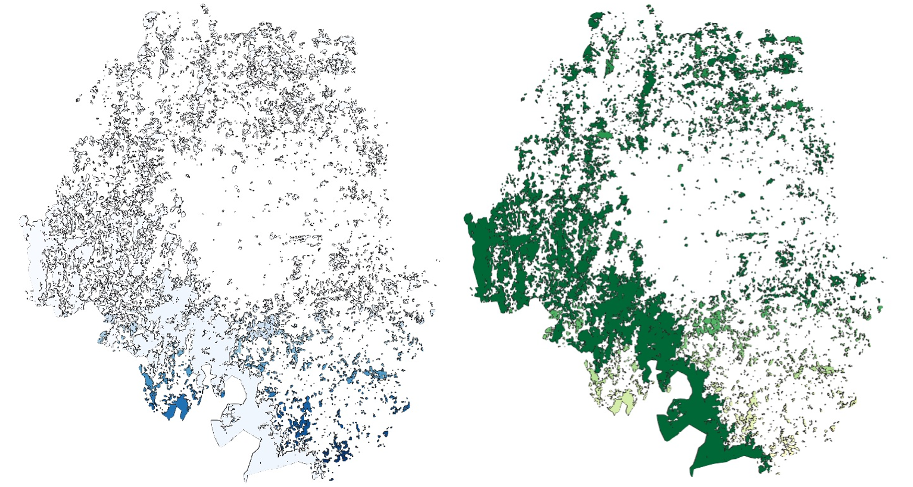
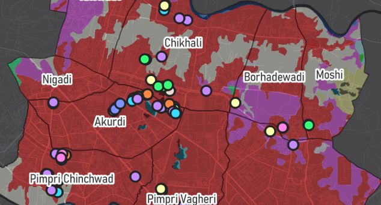
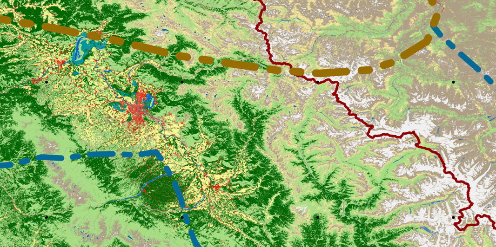
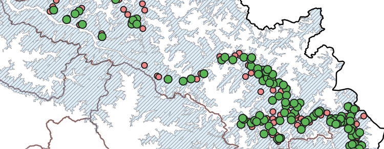

---
hide:
  - toc
  - navigation
---
<!--
CHECKLIST FOR THIS PAGE:
- [ ] Replace the two placeholder cards (marked [YOUR PROJECT ...]) with your real projects
- [ ] For each project: add a thumbnail image to docs/assets/images/ and update the path below
- [ ] For each project: create a project page by copying sample-project.md
- [ ] For each project: add a nav entry in mkdocs.yml (see the comments there)
- [ ] Delete placeholder cards you don't need yet
-->

# Projects

A selection of my geospatial projects. Click any card to see the full write-up.

**[Mammal Distributions in the High Altitudes of Jammu & Kashmir](jk-sdm.md)**

Stacked species distribution models for ten mammal species, built from 1.5-2 years of camera trap data and 22 environmental covariates. The work began as a snow leopard range assessment and expanded to the wider high-altitude mammal community.

`R` `SSDM` `Google Earth Engine` `QGIS`

[View Project →](jk-sdm.md){ .md-button }

**[Lahaul Wildlife Management Plan](lahaul-management-plan.md)**

Produced maps towards a wildlife management plan for the Lahaul Forest Division, Himachal Pradesh, submitted to the Forest Department. My maps cover the snow leopard distribution and the proposed hydropower projects in the valley.

`QGIS`  `Google Earth Engine` `R`

[View Project →](lahaul-mgmt.md){ .md-button }

**[Urban Expansion and Habitat Quality in Bengaluru's IT Belt](thesis.md)**

MSc dissertation mapping 20 years of land-cover change across four tehsils of Bengaluru's IT belt using Landsat imagery, then modelling habitat quality and rarity with InVEST. Built-up area grew from 9% to 21% and the vegetation rapidly declined and was found to be fragmented.

`ArcGIS` `QGIS` `InVEST` `MOLUSCE`

[View Project →](thesis.md){ .md-button }

**[River Pollution Monitoring in India](river-pollution.md)**

Statistical analysis of 2021 CPCB water-quality data from 1,444 monitoring stations, focused on five major rivers. Yamuna had the highest mean BOD and fecal coliform, and temperature alone turned out to be a weak predictor of pollution indicators.

`R` `Correlation` `Regression`

[View Project →](river-pollution.md){ .md-button }

**[Open Natural Ecosystems and Biodiversity in Bengaluru](one.md)**

Team analysis for an OpenCity datajam on whether "wastelands" in Bengaluru work as overlooked biodiversity habitats. ONEs held 142 species and about 65% of geocoded real estate projects fall within 500 m of one. Published in Citizen Matters.

`Google Earth Engine` `QGIS` `R`

[View Project →](one.md){ .md-button }

**[Unsung Heroes Among Us: Mentoring students for mapping in Pune](unsung-heroes.md)**

Volunteer GIS mentorship for students of Vidya Niketan English Medium School, Pune. They mapped 116 informal service workers in their neighbourhood against the SDGs and presented the work at the UN World Geospatial Information Congress in Hyderabad.

`QGIS` `Google Earth Engine` `EpiCollect`

[View Project →](unsung-heroes.md){ .md-button }

**[Together for the Mountains: NCF High Altitude Program Map](mol.md)**

An overview map of the Nature Conservation Foundation's High Altitude Program, showing snow leopard camera-trap locations and  partner community villages across the Western Himalaya. Printed for the Mountains of Life festival at Azim Premji University.

`QGIS` `Cartography` `ESA WorldCover`

[View Project →](mol.md){ .md-button }

**[Status of Snow Leopard in Himachal Pradesh (PAWS)](paws-2.md)**

State-wide snow leopard population assessment by the HP Forest Department and NCF. I curated about 4.5 lakh camera-trap images, made all the report's maps, and built the species distribution models for other mammals in the landscape.

`QGIS` `R` `SSDM` `Camera traps`

[View Project →](paws-2.md){ .md-button }

