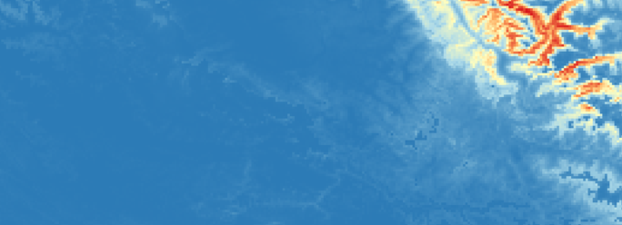
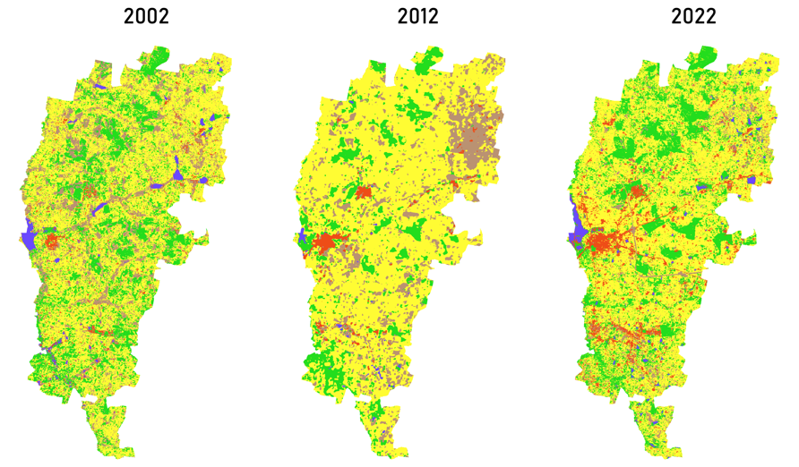

---
hide:
  - toc
  - navigation
---
<!--
CHECKLIST FOR THIS PAGE:
- [ ] Replace the two placeholder cards (marked [YOUR PROJECT ...]) with your real projects
- [ ] For each project: add a thumbnail image to docs/assets/images/ and update the path below
- [ ] For each project: create a project page by copying sample-project.md
- [ ] For each project: add a nav entry in mkdocs.yml (see the comments there)
- [ ] Delete placeholder cards you don't need yet
-->

# Projects

A selection of my geospatial projects. Click any card to see the full write-up.

**[Mammal Distributions in the High Altitudes of Jammu & Kashmir](jk-sdm.md)**

Stacked species distribution models for ten mammal species, built from 1.5-2 years of camera trap data and 22 environmental covariates. The work began as a snow leopard range assessment and expanded to the wider high-altitude mammal community.

`R` `SSDM` `Google Earth Engine` `QGIS`

[View Project →](jk-sdm.md){ .md-button }

**[Lahaul Wildlife Management Plan](lahaul-management-plan.md)**

Produced maps towards a wildlife management plan for the Lahaul Forest Division, Himachal Pradesh, submitted to the Forest Department. My maps cover the snow leopard distribution and the proposed hydropower projects in the valley.

`QGIS`  `Google Earth Engine` `R`

[View Project →](lahaul-mgmt.md){ .md-button }

**[Urban Expansion and Habitat Quality in Bengaluru's IT Belt](thesis.md)**

MSc dissertation mapping 20 years of land-cover change across four tehsils of Bengaluru's IT belt using Landsat imagery, then modelling habitat quality and rarity with InVEST. Built-up area grew from 9% to 21% and the vegetation rapidly declined and was found to be fragmented.

`ArcGIS` `QGIS` `InVEST` `MOLUSCE`

[View Project →](thesis.md){ .md-button }

