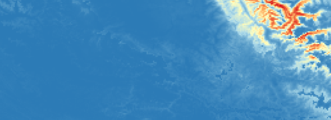

# Mammal Distributions in the High Altitudes of Jammu & Kashmir

`R` `SSDM` `Google Earth Engine` `QGIS` `Camera trapping` `Species distribution modelling`

- **Context:** Research collaboration between NCF and the Department of Wildlife Protection, J&K
- **Duration:** ~2 years
- **Study area:** High-elevation regions of Jammu & Kashmir (Kishtwar Himalayas)

## Overview

This project started as an assessment of snow leopard range in the high altitudes of Jammu & Kashmir. Partway through, we widened the scope to the other mammals recorded on the same camera traps. The result is a set of distribution models for ten species, several of which had not been modelled in this region before.

## Data

- **Occurrence records:** Camera trap detections from stations deployed over 1.5-2 years across different seasons. Species were identified manually from the images to build the training dataset.
- **Climate covariates:** The 19 WorldClim bioclimatic variables (BIO1-BIO19).
- **Terrain and vegetation covariates:** Ruggedness, slope and NDVI, derived in Google Earth Engine.

## Methods

1. **Covariate preparation.** Terrain and NDVI layers were generated in Google Earth Engine and combined with the bioclimatic layers. Collinearity among the 22 variables was assessed with the `usdm` package.
2. **Modelling.** I used the `SSDM` package in R to build stacked species distribution models. Eight algorithms were compared for each species: GAM, MaxEnt, GBM, GLM, CTA, ANN, RF and MARS.
3. **Validation.** Model performance was evaluated with TSS and Kappa, and the best-performing models were retained.
4. **Mapping.** Final outputs were laid out and published as maps in QGIS.

## Species modelled

| Species | Scientific name |
|---|---|
| Brown bear | *Ursus arctos* |
| Himalayan ibex | *Capra sibirica* |
| Long-tailed marmot | *Marmota caudata* |
| Mountain weasel | *Mustela altaica* |
| Musk deer | *Moschus leucogaster* |
| Red fox | *Vulpes vulpes* |
| Snow leopard | *Panthera uncia* |
| Eurasian stoat | *Mustela erminea* |
| Stone marten | *Martes foina* |
| Yellow-throated marten | *Martes flavigula* |

## Key Findings

The models gave distribution maps for all ten species, several of them for the first time in this region. Each species showed a distinct pattern tied to terrain and landscape type, with different parts of the landscape acting as niches for different species.

### Predicted distributions

=== "Snow leopard"
    { width="100%" }

=== "Himalayan ibex"
    { width="100%" }

=== "Brown bear"
    { width="100%" }

=== "Red fox"
    { width="100%" }

=== "Stone marten"
    { width="100%" }

=== "Musk deer"
    { width="100%" }

=== "Stoat"
    { width="100%" }

## Results

The models gave distribution maps for all ten species, several of them for the first time in this region. Each species showed a distinct pattern tied to terrain and landscape type, with different parts of the landscape acting as niches for different species.

<!-- Add 2-3 of your best maps here, e.g.:

-->

<!-- Optional: add key numbers if you have them, e.g. number of camera stations,
number of images processed, TSS range across species -->

## Limitations and lessons

- **Small mammals were excluded.** We initially tried to include pikas and other small mammals, but they could not be reliably told apart in camera trap images because of their size.
- **Image processing was the main bottleneck.** Identifying species across lakhs of images to build the training dataset took a large share of the project time. A better workflow for screening and labelling images would have saved a lot of effort.

## Outputs

- [NCF project page](https://www.ncf-india.org/high-altitudes/status-of-snow-leopardsand-other-high-altitude-mammals-in-kishtwar-himalayas-jammu-and-kashmir)
- [Full report (PDF)](https://images.assettype.com/ncfindia/2025-08-11/3y3e0qu7/Snow_leopard_NEW_REPORT_2025_FINAL_PRINT_compressed.pdf)

## Collaboration

Conducted as part of a research collaboration between the Nature Conservation Foundation and the Department of Wildlife Protection, Jammu & Kashmir.

[← Back to Projects](index.md){ .md-button }