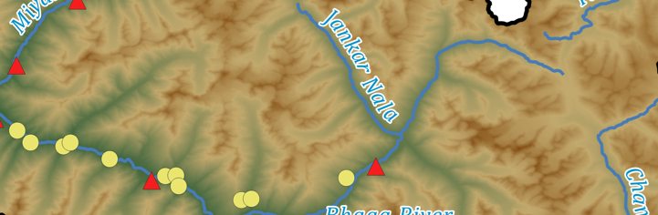
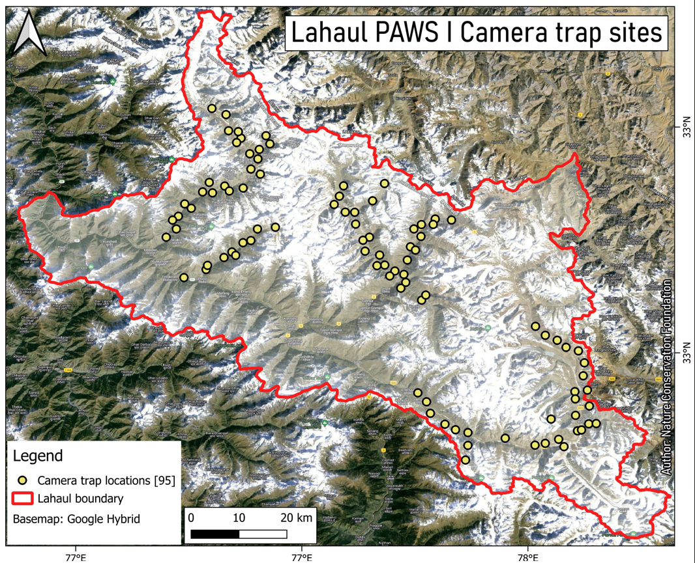
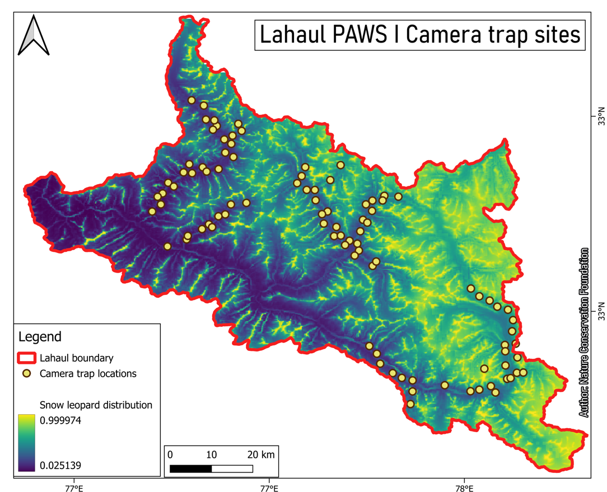
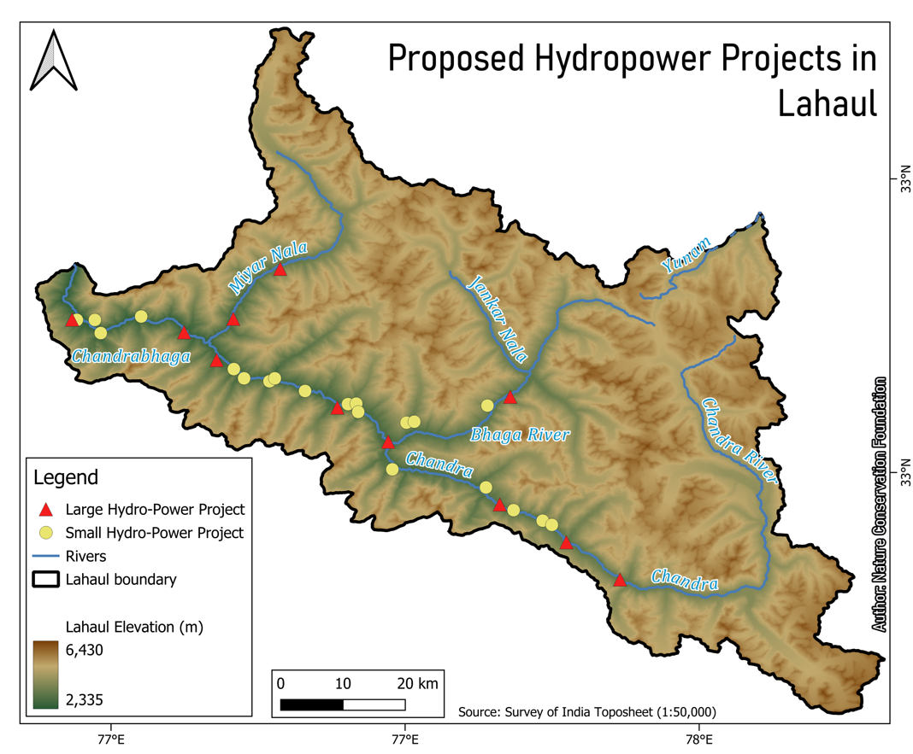
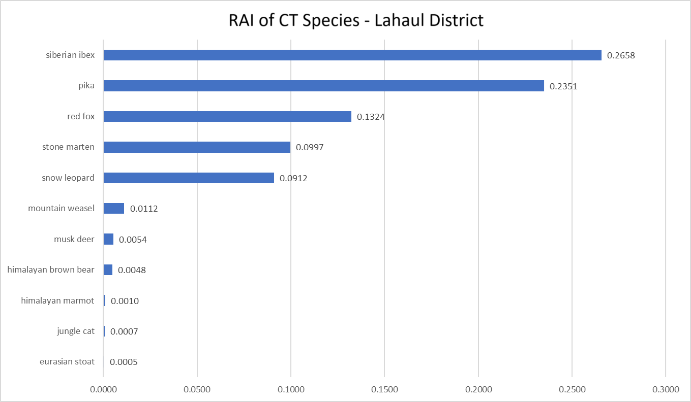

# Lahaul Wildlife Management Plan

- **Role:** Spatial analysis and maps
- **Tools:** QGIS, Google Earth Engine
- **Effort:** About two weeks, as one contributor to a larger plan
- **Status:** Submitted to the Himachal Pradesh Forest Department

## Overview

The Lahaul Forest Division in Lahaul and Spiti sits between the Pir Panjal and the Trans-Himalaya. It supports snow leopard, Himalayan brown bear, ibex, musk deer and Himalayan tahr, and is also a working agro-pastoral landscape. The management plan sets out how the Forest Department can conserve wildlife and habitat, reduce human-wildlife conflict and curb poaching across the division.

I was one of several contributors. My part was spatial: I made three of the plan's maps and wrote the text around the hydropower map.

## What the plan covers

- **Wildlife and habitat:** mammals, birds and medicinal plants of the valley, and snow leopard status from the state-wide PAWS survey.
- **Human-wildlife conflict:** livestock and crop depredation, free-ranging dogs, garbage, and a prevent-offset-inform framework for human-bear conflict.
- **Pressures on habitat:** grazing, disease transmission, medicinal plant harvest and poaching.
- **Management actions:** village-level micro-plans, compensation, conservation education, research and monitoring, and staff training.
- **Infrastructure:** the effect of linear infrastructure and proposed hydropower projects on the landscape.

## My contribution

I produced the following maps in QGIS and Google Earth Engine. The RAI analysis was done in R.

=== "Camera Traps"
    { width="100%" }

=== "Snow Leopard Distribution"
    { width="100%" }

=== "Hydro Projects"
    { width="100%" }

=== "Relative Abundance Index"
    { width="100%" }

## Hydropower and development

The plan ends with the infrastructure section. Many development projects are proposed across the valley, including hydropower, so the plan argues that wildlife spaces need a management plan in place before those projects proceed. It also notes the climate and disaster risks to hydropower, such as changing rainfall, discharge uncertainty and siltation. Local concerns about land and livelihoods are noted too. The Hydro Projects map shows where the proposed projects fall in the valley. It draws on Chandel & Rana (2024), *Current World Environment*, 18(3), 1345–1355.

## Data and tools

- QGIS for cartography and spatial layers
- Google Earth Engine for terrain and river layers
- R for RAI analysis

The plan was submitted to the Forest Department and is not publicly available.