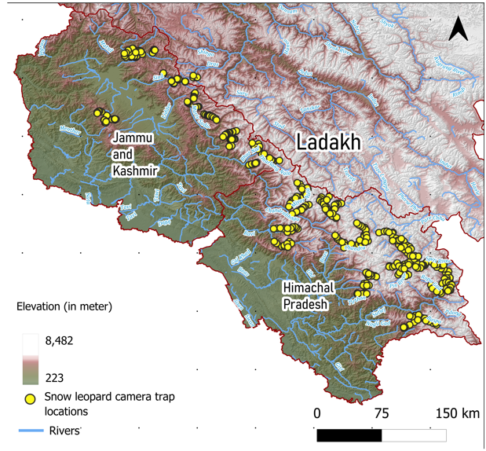
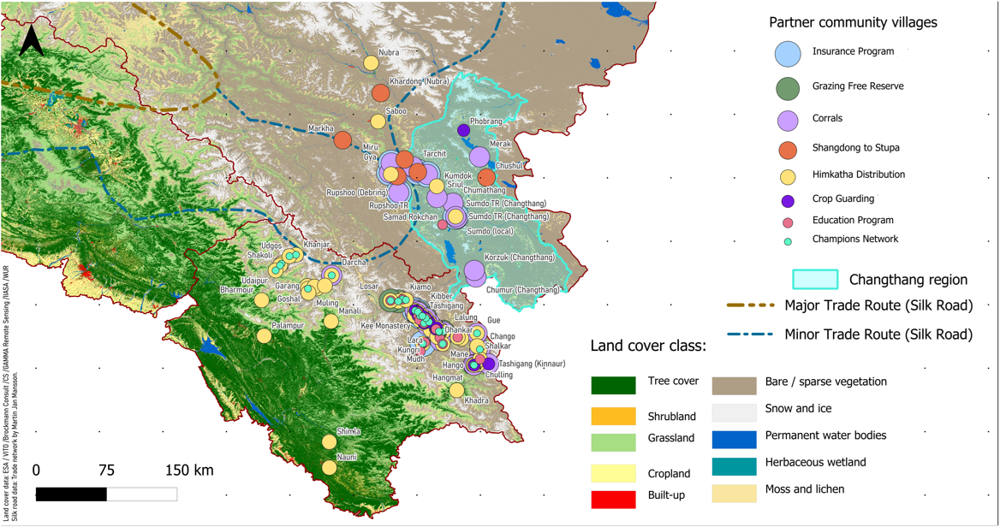

# Together for the Mountains

=== "Research"
    { width="100%" }

=== "Outreach"
    { width="100%" }

- **Type:** Cartographic design, made during my time at the Nature Conservation Foundation (NCF)
- **Format:** A0 printed poster
- **Tools:** QGIS, ESA WorldCover 10m
- **Shown at:** Mountains of Life festival, Azim Premji University, Bengaluru campus, 6–16 December 2024

## Overview

NCF's High Altitude Program works on snow leopard research and community-based conservation across the Western Himalaya. I made this poster to show the reach of that work at a glance, for school and university students visiting the Mountains of Life festival at Azim Premji University.

The poster has two maps. One shows where the program has studied snow leopards. The other shows where it works with communities.

## What the maps show

- **Research footprint:** Snow leopard camera-trap locations across Jammu & Kashmir, Ladakh and Himachal Pradesh, over elevation and the river network. The points come from years of fieldwork by the program team.
- **Community work:** Partner villages, with each programme type marked at the village where it operates. The types shown are insurance programme, grazing-free reserve, corrals, Shangdong to Stupa, Himkatha distribution, crop guarding, education programme and champions network.
- **Landscape context:** land cover from ESA WorldCover, the Changthang region outlined, and the major and minor Silk Road trade routes that cross the landscape.

## Design

Showing 25 years of fieldwork on one sheet meant balancing density and clarity. An inset places the study region in India. The top map shows the scale of the research. The bottom map uses sized and coloured symbols so that eight programme types in 92 villages can be read separately, with land cover kept in muted tones underneath. The poster also carries the logos of NCF, the Himachal Pradesh and Jammu & Kashmir Forest Departments, and Snow Leopard Trust.

## Learn more

Read about the High Altitude Program on the [NCF website](https://www.ncf-india.org/high-altitudes).

[Full length Poster](../assets/files/mountains_of_life.png){ .md-button }