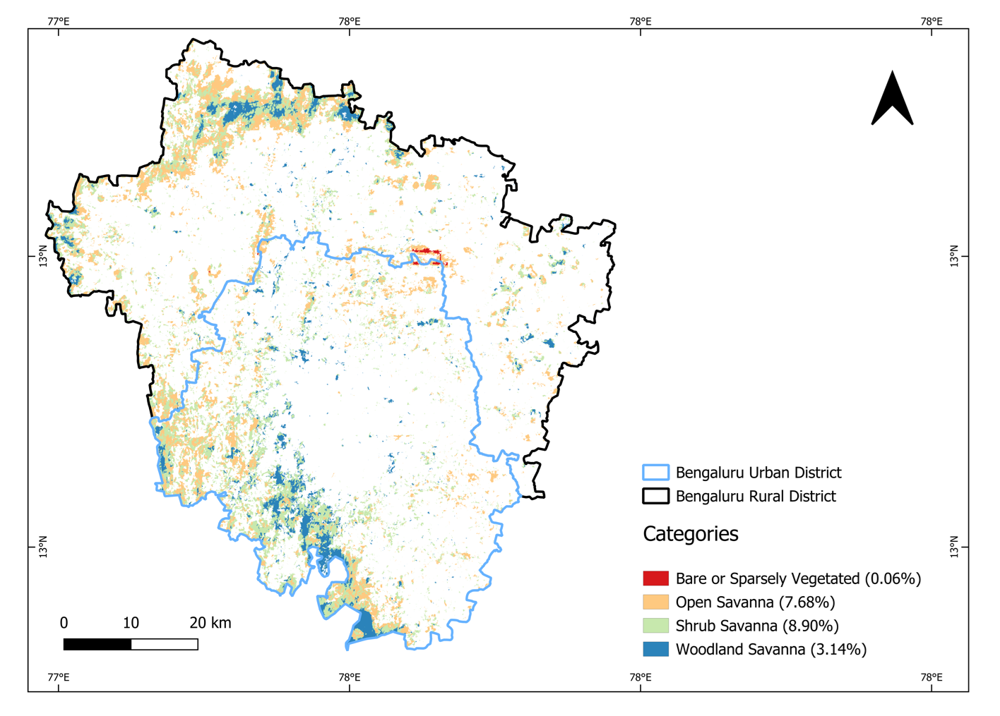

# Open Natural Ecosystems and Biodiversity in Bengaluru

- **Context:** Datajam hosted by OpenCity, an Oorvani Foundation initiative (December 2025)
- **Team:** A group of analysts, listed in the published article
- **Tools:** Google Earth Engine, QGIS, R
- **Role:** Sourced and queried the spatial data for the maps, and guided teammates on QGIS and spatial workflows
- **Published:** [Beyond the parks and gardens, Bengaluru's "wasteland" ecosystems call for protection](https://citizenmatters.in/open-natural-ecosystems-bengaluru-biodiversity/), Citizen Matters, March 2026

## Question

Indian land-cover classifications label degraded, underused or unused land as "wasteland". Many of these areas are scrublands, grasslands, rocky outcrops and seasonal wetlands, which are Open Natural Ecosystems (ONEs). We asked whether they work as overlooked biodiversity habitats across urban and peri-urban Bengaluru, and what development pressure they face.

## Data

- **Open Natural Ecosystems India:** ONE layers for the study area, extracted using Google Earth Engine
- **iNaturalist (2024) and eBird:** research-grade species observations
- **Karnataka RERA:** real estate project data, used to measure development pressure
- **Administrative boundaries:** Bengaluru Urban District and taluk shapefiles

## Approach

1. Mapped wastelands within the Greater Bengaluru Authority. They cover about 114 of its 712 km², and are underrepresented in citizen-science data, so we extended the study to Bengaluru Urban District.
2. Overlaid species observations on ONEs and non-ONE areas, and compared taxa between them.
3. Analysed patch aggregation and contiguity to see which habitat patches are connected and which are isolated.
4. Mapped RERA projects by taluk and measured their distance to ONEs with buffer analysis.

## My contribution

I sourced and queried the data behind our maps, and prepared the shapefiles and rasters that went into them. Because I work with QGIS regularly, I also helped teammates who were stuck and kept the analysis moving toward the direction we agreed on.

## Findings

- ONEs recorded **798 species**, against 1,671 in non-ONE areas, even though they cover far less area and are under-surveyed.
- **142 species** were recorded only in ONEs, including Golden Jackal, Chital, Common Silverline, Plain Hedge Blue, Yellow-throated Sparrow and Indian Vulture.
- Of 1,006 RERA projects with GPS coordinates, **649 (64.5%) lie within 500 m of an ONE**. Development pressure is concentrated in Bengaluru East, Bengaluru South and Anekal.
- Wastelands are among the largest remaining continuous habitat patches in peri-urban Bengaluru, and many wetland-associated species depend on the open land around water bodies, not only the water itself.

## Recommendations

The article calls for documenting ONEs as a distinct category instead of lumping them into "vacant land", and for baseline biodiversity assessments in peri-urban areas before large development approvals.

[Read the full article](https://citizenmatters.in/open-natural-ecosystems-bengaluru-biodiversity/){ .md-button }