# Status of Snow Leopard in Himachal Pradesh

=== "Effort"
    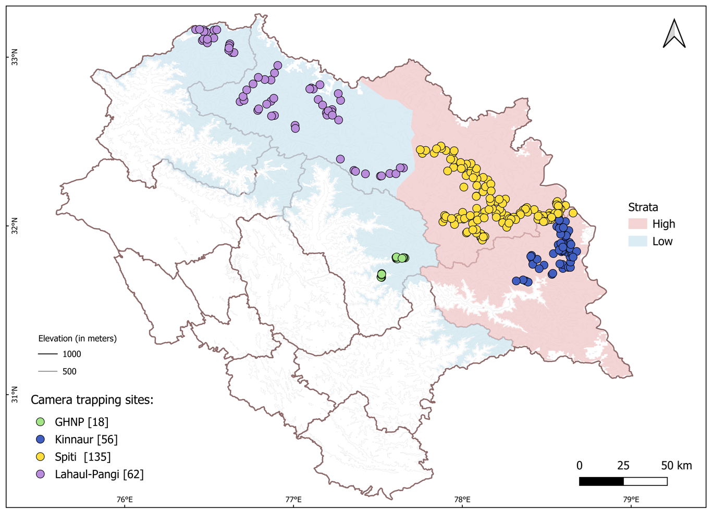{ width="100%" }

=== "Snow leopard Range"
    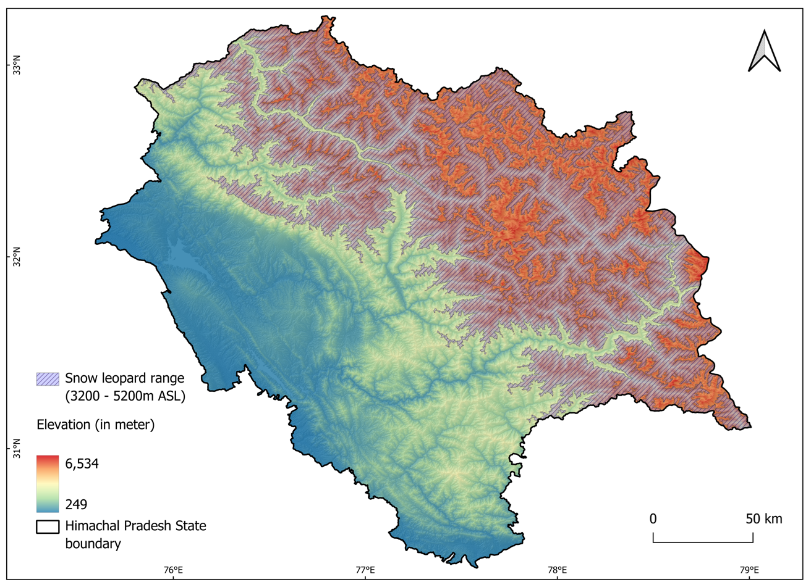{ width="100%" }

=== "Snow leopard detections"
    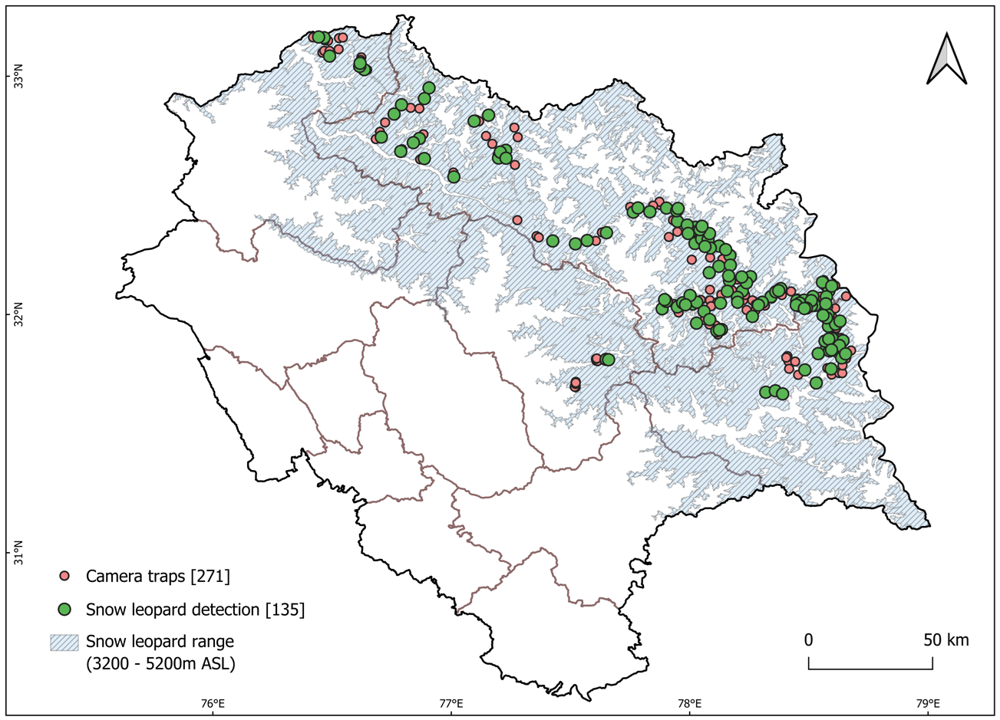{ width="100%" }

- **Report:** *Status of Snow Leopard in Himachal Pradesh, 2025*, Wildlife Wing, Himachal Pradesh Forest Department, in collaboration with the Nature Conservation Foundation (NCF)
- **Tools:** QGIS, R (SSDM)
- **Role:** Data curation, all maps, species distribution models and the report section on other mammals of the region
- **Article:** [Population Assessment of Snow Leopards and Species Distribution Modelling of Other Mammals in Himachal Pradesh using R and QGIS](https://in.qgis.org/case-studies/snow-leopard-spatial-planning/) (QGIS India User Group case study)
- **Read the report:** [Status of Snow Leopard in Himachal Pradesh, 2025](https://images.assettype.com/ncfindia/2025-10-13/wj7dw0hs/PAWS_Report_Final_Updated_040825_spreads__1_.pdf)

## Overview

This is the second state-wide assessment of snow leopards in Himachal Pradesh. The survey used camera traps in a stratified design over 26,112 km² of snow leopard habitat. It deployed 271 camera traps, identified 44 individual snow leopards from 262 independent detections, and estimated a state-wide density of 0.35 snow leopards per 100 km² (95% CI 0.23–0.53).

The camera traps also recorded many other mammals, so the same dataset was used to build a species distribution model for these species.

## My contribution

### Data curation

I curated the dataset of about 4.5 lakh camera-trap images. This meant identifying species in the images, discarding false triggers, and building a folder structure that served as the input for both the species distribution models and the density (SECR) analysis. The work went through several rounds of checking by me and the team.

### Maps

All the maps in the report were made by me, except for Figure 4. The following are the map outputs of the species distribution model. 

=== "Bharal"
    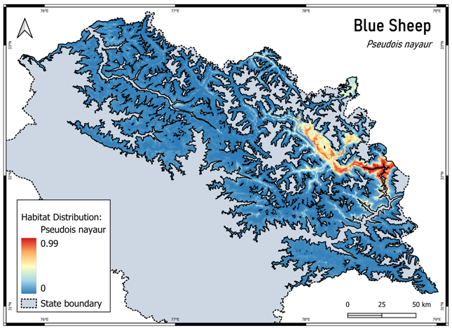{ width="80%" }

=== "Brown bear"
    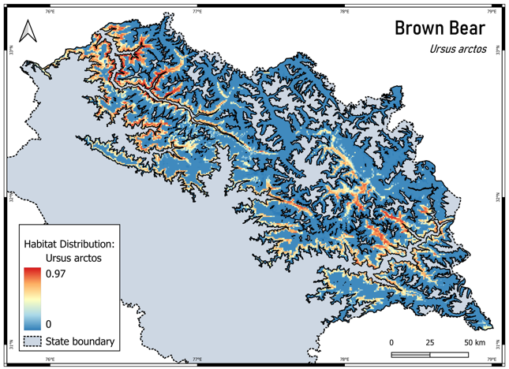{ width="80%" }

=== "Himalayan wolf"
    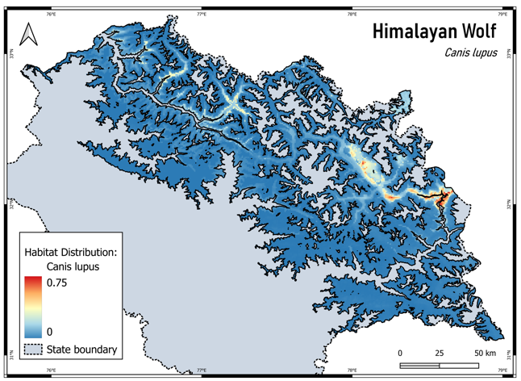{ width="80%" }

=== "Himalayan Ibex"
    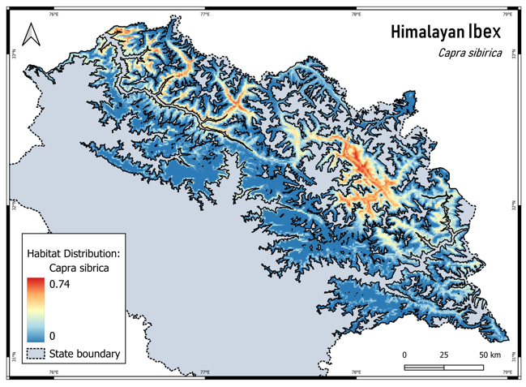{ width="80%" }

=== "Leopard"
    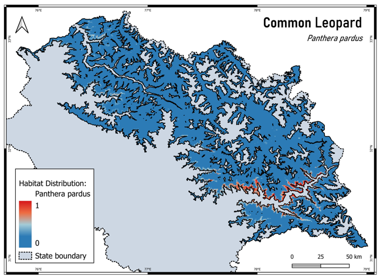{ width="80%" }

=== "Mountain weasel"
    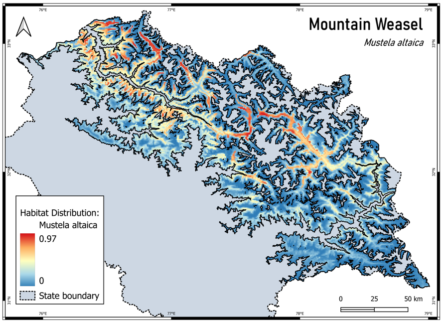{ width="80%" }

=== "Himalayan musk deer"
    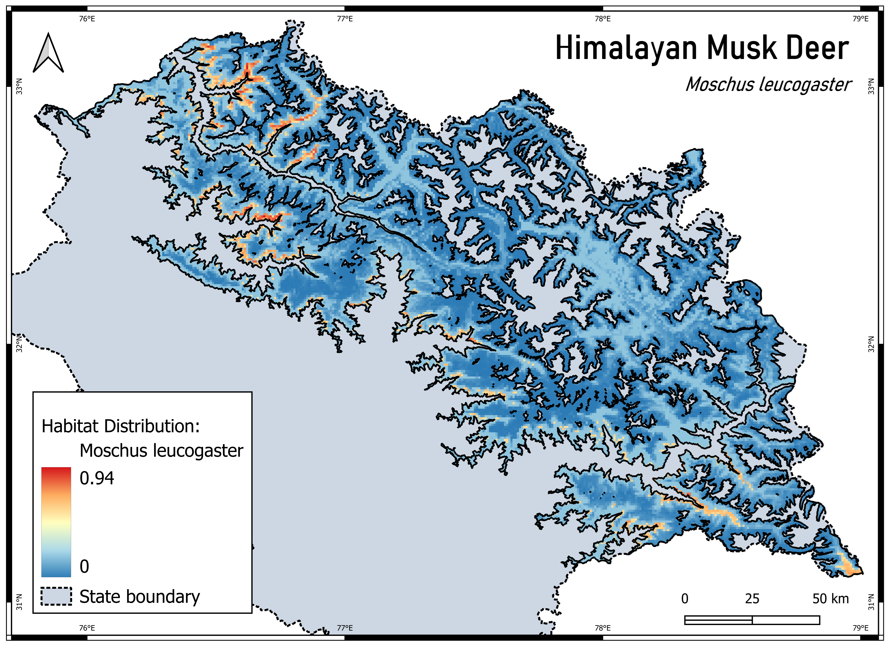{ width="80%" }

=== "Red fox"
    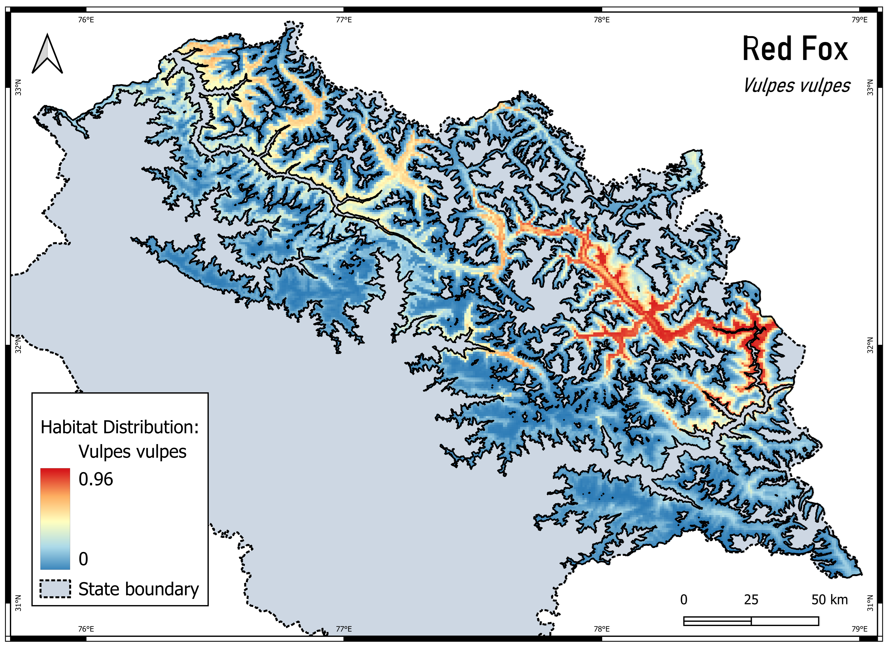{ width="80%" }

=== "Stone marten"
    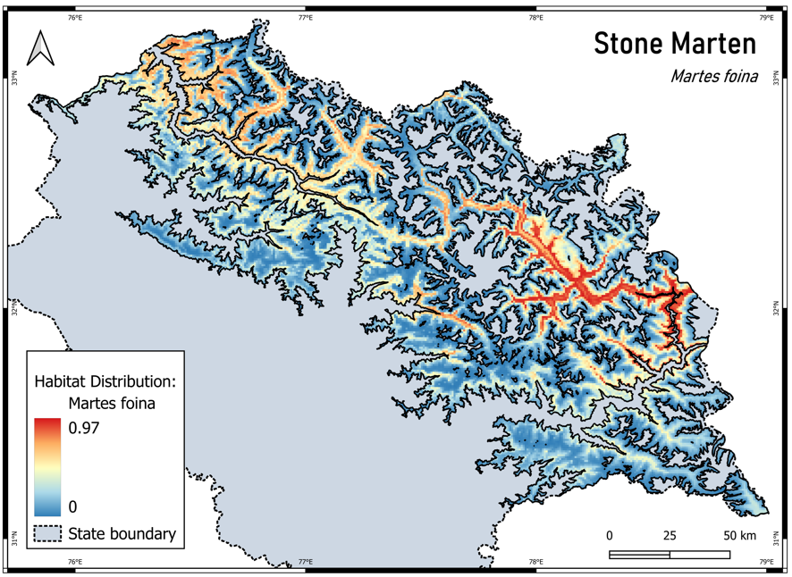{ width="80%" }

=== "Yellow-throated marten"
    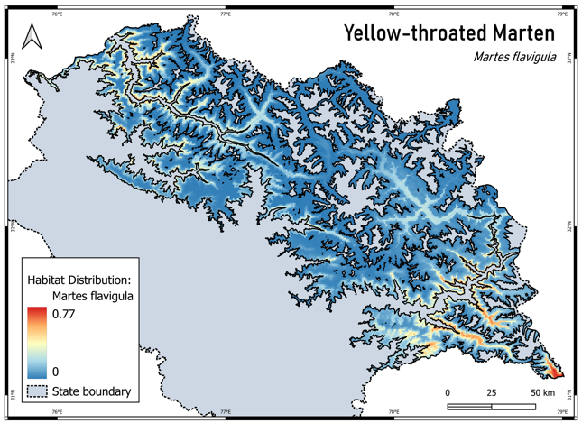{ width="80%" }

### Distribution of other mammals

I wrote the report section on the distribution of other mammals in the snow leopard landscape, and did the analysis behind it entirely in R:

- Built ensemble species distribution models with the SSDM package, which combines several algorithms and keeps the best-performing ones.
- Used uncorrelated environmental variables and spatially distinct occurrence points, with 70% of the data for calibration and 30% for testing.
- Generated 200–1,000 pseudo-absence points over 10 iterations to make the models more reliable.
- Modelled species recorded incidentally by the cameras, including blue sheep, Himalayan ibex, Himalayan musk deer, Himalayan brown bear, Himalayan wolf, common leopard, mountain weasel, red fox, stone marten and yellow-throated marten.

## Results from the distribution models

- The ensemble models performed well for all non-targeted species, with AUC from 0.92 to 0.99 and Kappa from 0.72 to 0.85.
- **Ibex** occur mainly in rugged terrain, from Pin valley westward, and across the Bhaga, Miyar and Chandra valleys in Lahaul, and parts of Chamba. **Blue sheep** are more restricted, mostly around Hangrang valley and the Spiti region, preferring undulating ground near cliffs.
- **Musk deer** occur across the Greater Himalayas, especially Chamba, parts of Lahaul, Kullu and lower Kinnaur, mostly near tree cover.
- **Brown bears** occur across valleys in Lahaul, Chamba and parts of Kinnaur, typically along valleys and near meadows.
- **Wolves** favour the rolling, plateau-like areas of Spiti and Lahaul, and **common leopards** have high occurrence along the southern rims of the snow leopard landscape.
- The cameras also recorded the **first confirmed records** in the state of Pallas's cat (near Nako, Kinnaur) and Woolly flying squirrel (Miyar valley, Lahaul).

These maps can help refine range maps, identify biodiversity hotspots and potential corridors, and support conservation planning beyond snow leopards.