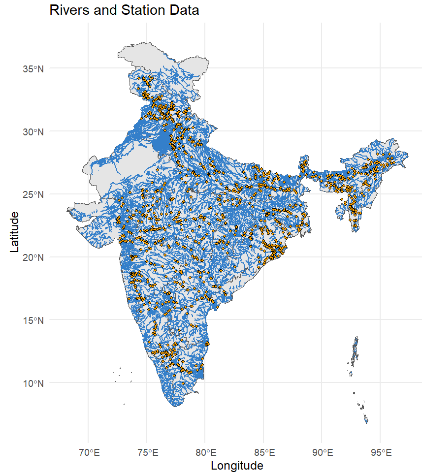
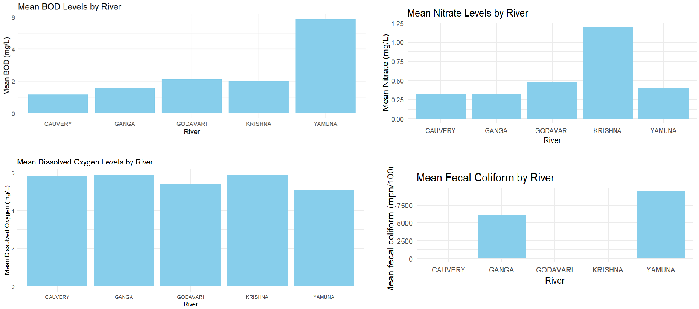
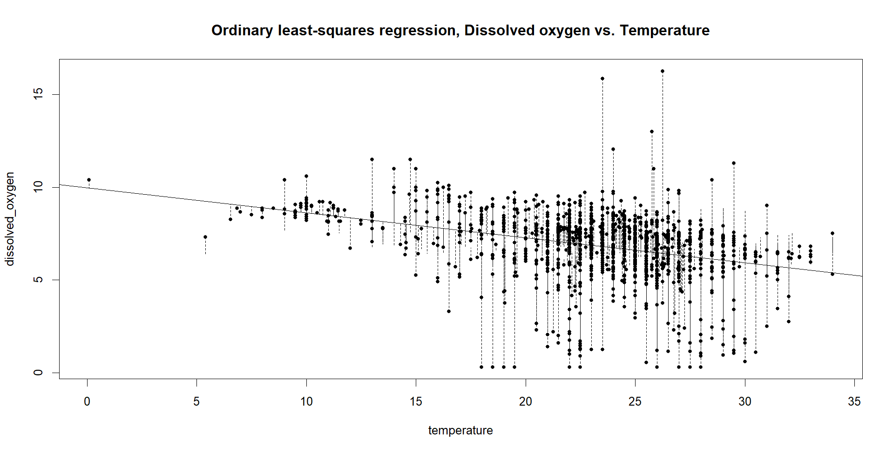
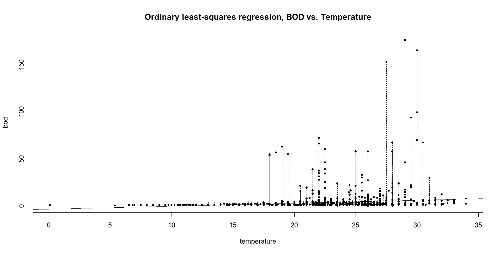
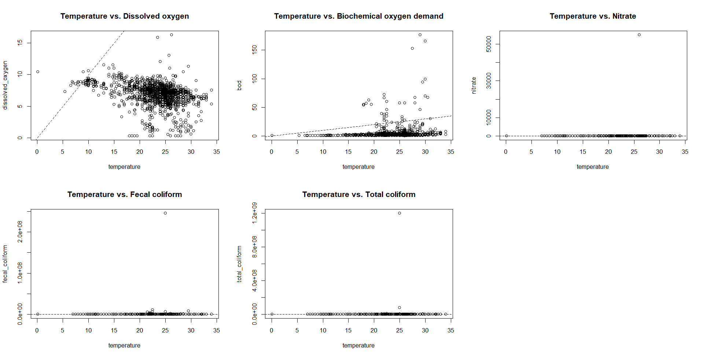

# River Pollution Monitoring in India

=== "Stations"
    { width="100%" }

=== "Pollutant levels"
    { width="100%" }

=== "DO vs. Temp. Regression"
    { width="100%" }

=== "BOD vs. Temp. Regression"
    { width="100%" }

=== "Scatter plots"
    { width="100%" }

- **Context:** Group project at the end of a week-long advanced R workshop at Azim Premji University
- **Data:** Central Pollution Control Board (CPCB) river water-quality data, 2021
- **Tools:** R
- **Role:** Analysis, graphs and maps

## Question

India's rivers support large populations, serving as a lifeline for many cities, towns and farmlands along their banks. The CPCB records physical, chemical and biological water-quality indicators at monitoring stations across the country. This project asked how those indicators differ between rivers and how they relate to each other.

## Data

The 2021 CPCB dataset covers 1,444 monitoring stations. It was published as PDF tables, so we extracted it into analysable form with R, cleaned it into a tidy format, and averaged the values. We then selected five major rivers: Cauvery, Ganga, Godavari, Krishna and Yamuna.

Indicators analysed:

- **Dissolved oxygen:** oxygen available to aquatic life
- **Biochemical oxygen demand (BOD):** a measure of organic pollution
- **Nitrate:** high levels can cause eutrophication
- **Fecal coliform:** an indicator of contamination from human and animal waste
- **Temperature:** affects both metabolic rates and oxygen solubility

## Approach

1. Extracted and cleaned the CPCB data into a tidy format.
2. Summarised each parameter by river and compared stations with boxplots and histograms.
3. Tested correlations between temperature and the other parameters (Pearson's correlation).
4. Fitted linear regressions of each parameter on temperature.

## Findings

- **Yamuna is the most polluted of the five.** It has the highest mean BOD and the highest mean fecal coliform, with the Ganga next on fecal coliform. Cauvery, Godavari and Krishna are far lower.
- **Krishna has the highest mean nitrate.**
- **Temperature is correlated with dissolved oxygen** (r = −0.34, p < 0.001): warmer water holds less oxygen. Its relationship with BOD is weak (r = 0.13), and there is no significant relationship with nitrate or fecal coliform.
- **Temperature alone is a poor predictor.** Adjusted R² is 0.12 for dissolved oxygen and close to zero for BOD, nitrate and fecal coliform. Pollution levels depend on other factors that this analysis did not model, such as discharge, sewage load and land use.

## Takeaway

The indicators do not move together in a simple way, and effective, periodic monitoring is what makes interpretation possible. Understanding how these parameters behave helps identify sources of contamination and supports preventive action.

## Limitations

The analysis covers one year and five rivers, and it uses temperature as the only predictor. A fuller model would add more variables and look at differences between stations along each river.