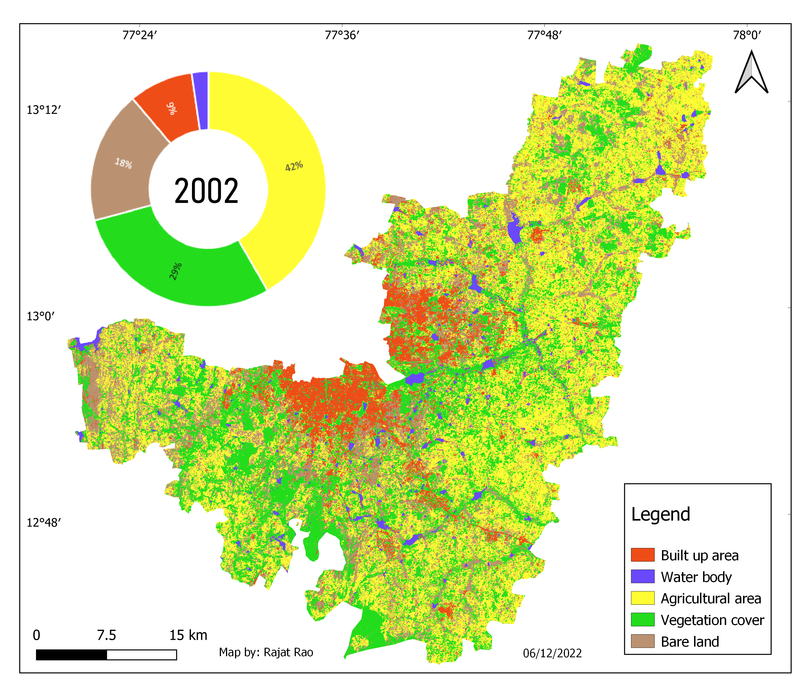
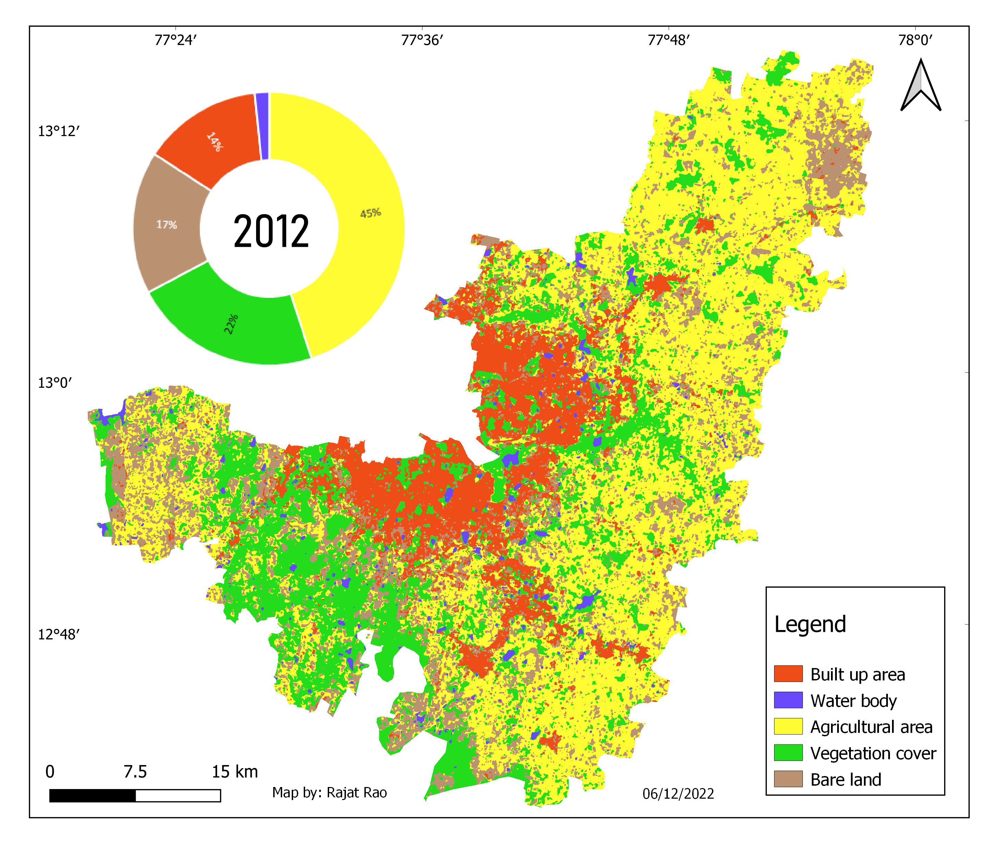
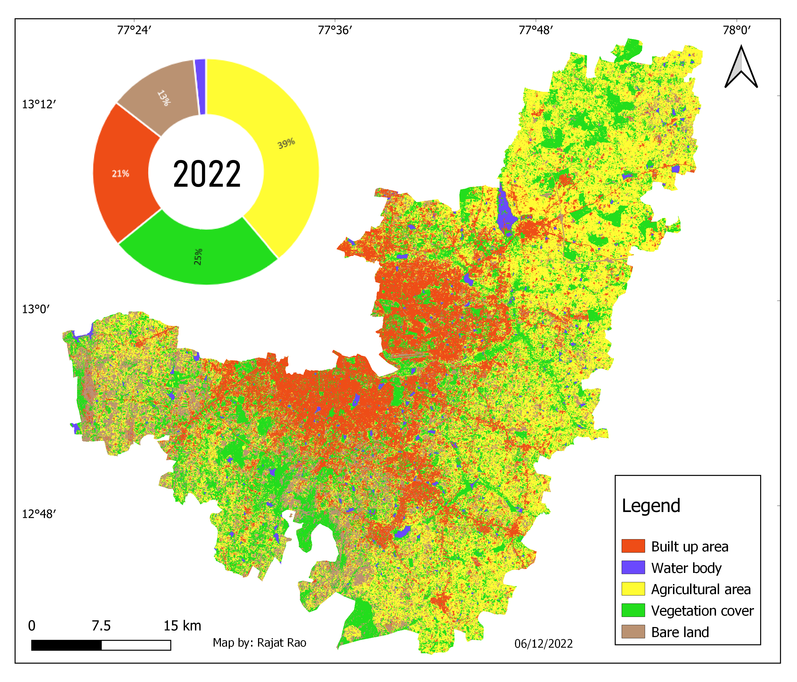
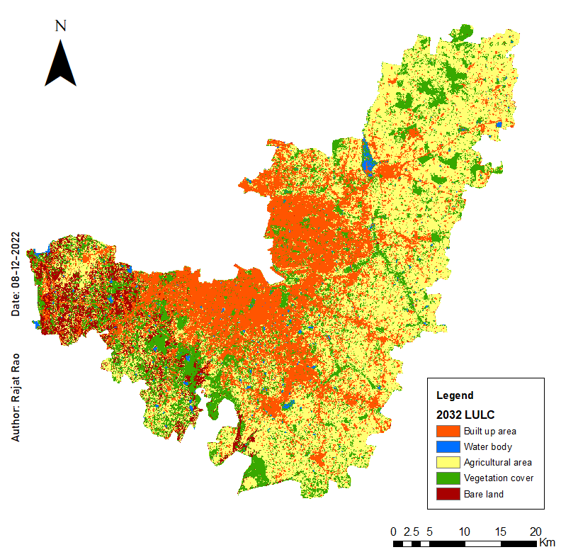
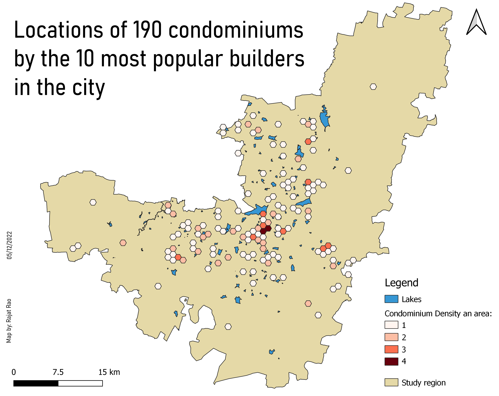
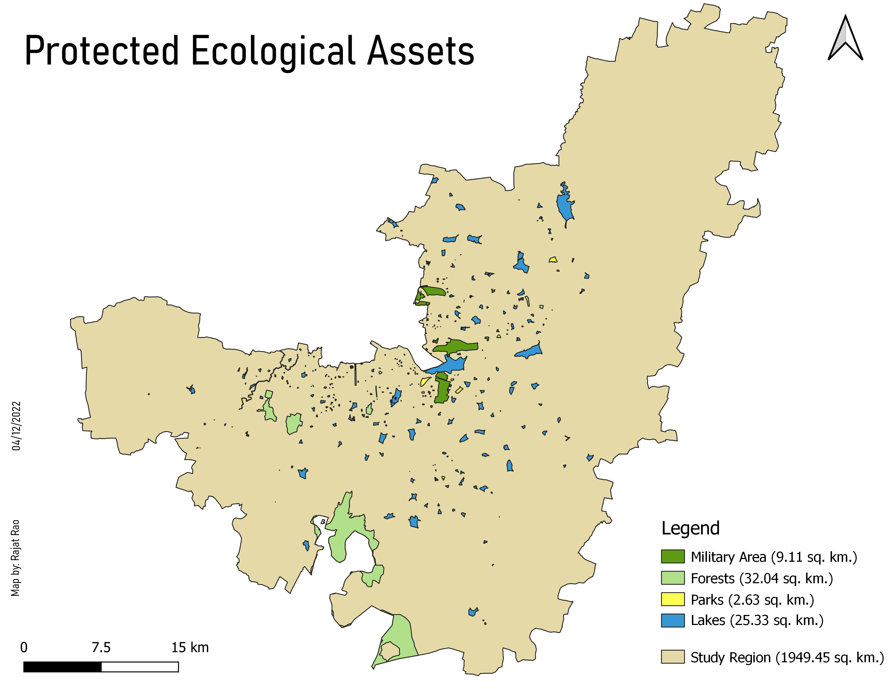
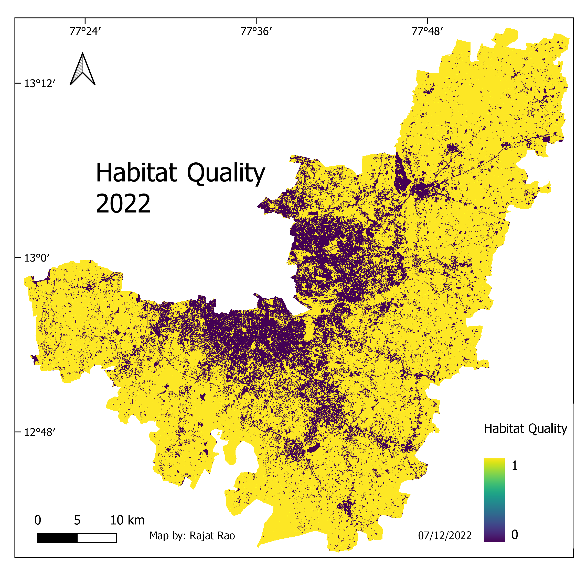
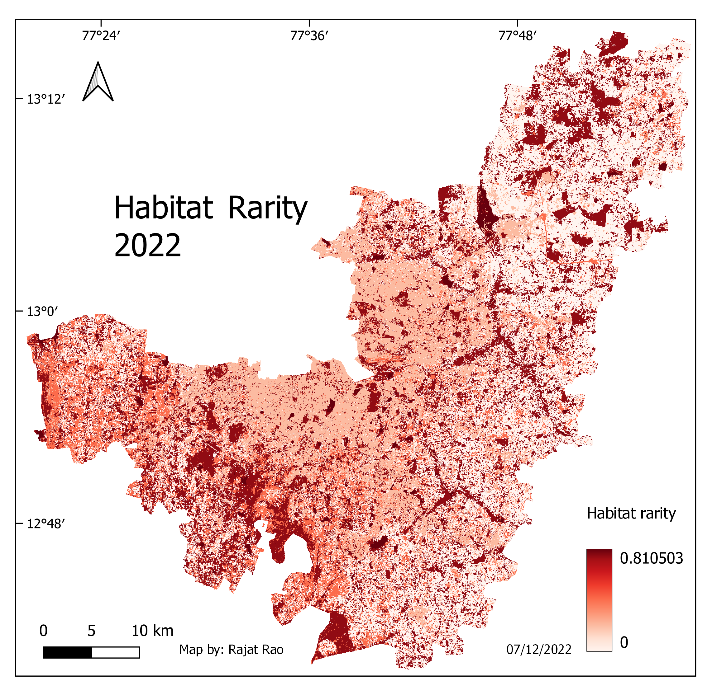

# Urban Expansion and Habitat Quality in Bengaluru's IT Belt

=== "2002"
    { width="100%" }

=== "2012"
    { width="100%" }

=== "2022"
    { width="100%" }

=== "2032"
    { width="100%" }

=== "Large Condominium density"
    { width="100%" }

=== "IT company density"
    { width="100%" }

=== "Protected regions"
    { width="100%" }

=== "Habitat Quality"
    { width="100%" }

=== "Habitat Rarity"
    { width="100%" }

- **Type:** MSc dissertation, Wildlife Conservation Action
- **Institution:** Institute of Environment Education and Research, Bharati Vidyapeeth Deemed University, Pune (2022–23)
- **Supervisor:** Prof. Dr. Kranti Yardi
- **Tools:** ArcGIS, QGIS (MOLUSCE), ERDAS Imagine, InVEST, Google Earth Pro
- **Role:** Sole researcher; designed and carried out the study

## Question

Bengaluru's IT industry has pushed the city out into former farmland, lakes and scrub forest. This study asked how fast built-up area has spread across the IT belt, what it replaced, and what that does to habitat quality for the species that live there.

## Study area

Four tehsils covering about 1,950 km²: Bangalore East, Bangalore South and Anekal (Bangalore Urban), and Hoskote (Bangalore Rural). Together they contain most of the city's tech parks and SEZs, 126+ lakes and green spaces, and the edge of Bannerghatta National Park. I chose them because each represents a different stage of urbanisation, from the established core to rural fringe.

## Approach

1. **Land cover mapping, 2002, 2012 and 2022.** Landsat 7 ETM+ and Landsat 8 OLI scenes from February to March, corrected and classified with a support vector machine. I repaired the scan-line gaps in the 2012 image in ERDAS Imagine. About 500 stratified ground-truth points per year, validated against historical imagery, gave kappa values of 86.8% (2002), 81.8% (2012) and 84.9% (2022).
2. **Change analysis.** Class-to-class transitions for 2002–12 and 2012–22, at region and tehsil level.
3. **Baseline map.** A 1955 land-cover map, built by georeferencing, mosaicking and classifying four US Army Map Service toposheets, used as the historical baseline for the habitat model.
4. **Future scenario.** A 2032 land-cover projection from an artificial neural network in the QGIS MOLUSCE plugin.
5. **Habitat quality and rarity.** The InVEST Habitat Quality model run for 2022 and 2032, with built-up land as the main threat. I counted agriculture and other green space as habitat, since they support birds, reptiles and other species in and around the city.
6. **Context mapping.** Surveyed and mapped 449 tech parks and companies, plus high-rise condominium complexes, to set the land-cover results in context.

## Findings

- Built-up area rose from **9% to 21%** of the study region between 2002 and 2022, mostly at the expense of agriculture and vegetation.
- Vegetation cover fell from **29% to 25%**, and what remains became fragmented.
- Habitat quality is preserved only in a few hotspots, mostly protected areas. Habitat rarity is limited to small pockets and falls in the 2032 projection.
- Many green spaces and tree avenues in the region have no formal protection.
- Condominium development is spreading into low-lying land, mostly lake flood plains.

## Limitations

The 2032 projection has about 55% validation accuracy, so I treat it as indicative rather than predictive. Landsat's 30 m resolution also limits how well small green spaces can be resolved.

## Recommendations

The thesis proposes a multi-stakeholder plan involving the municipal and forest departments, builders, IT firms through CSR, and citizens. The plan combines this ecological data with a social component on residents' vision for the city, and promotes ecosystem-services-based town planning, indigenous plantations and biodiversity-friendly construction.

[Download the full thesis (PDF)](../assets/files/Thesis_RajatRao_WCA.pdf){ .md-button }