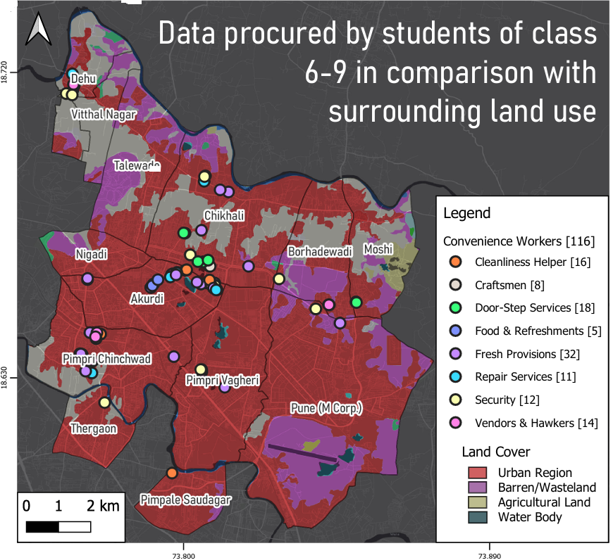
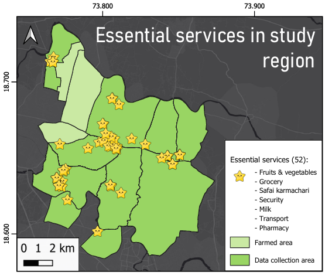
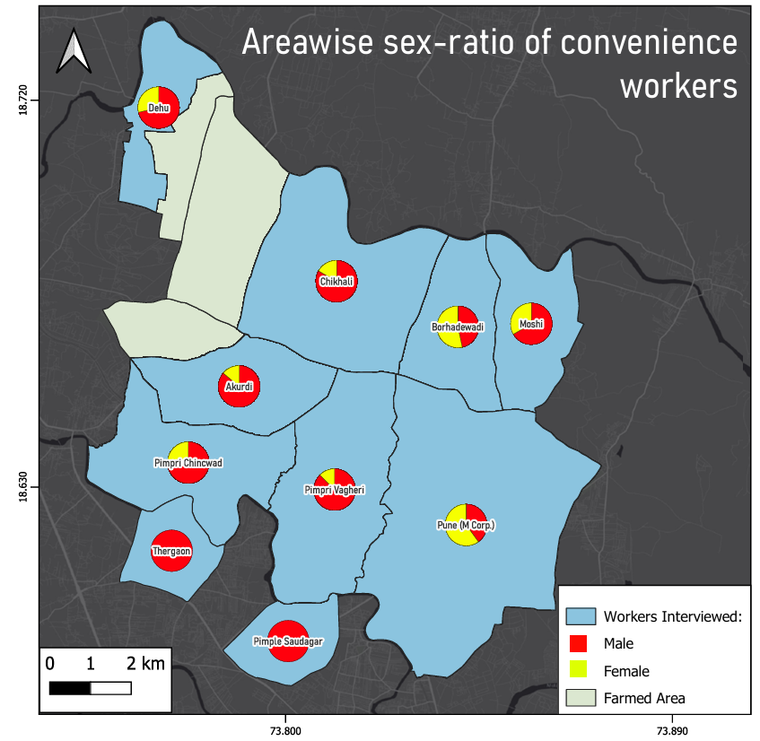
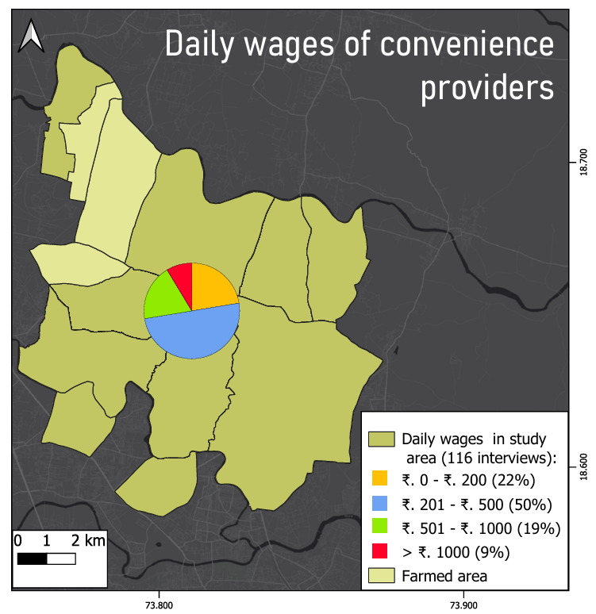

# Unsung Heroes Among Us

=== "Data collected"
    { width="100%" }

=== "Essential services"
    { width="100%" }

=== "Sex ratio"
    { width="100%" }

=== "Daily wages"
    { width="100%" }

- **Type:** Volunteer GIS mentorship (during my MSc)
- **School:** Vidya Niketan English Medium School, Pune
- **Participants:** Students of classes 6–9, a coordinating teacher, and a student lead
- **Duration:** About one month of after-school sessions, held over Google Meet
- **Tools:** EpiCollect, QGIS, Google Earth Engine
- **Outcome:** Presented at the UN World Geospatial Information Congress (UNWGIC), Hyderabad, 2022, as a presentation and a poster

## Overview

I mentored a group of school students through their first GIS project. The students chose the topic: the informal workers who keep a neighbourhood running, such as vendors, helpers, repairers and security staff. The went on field, interviewed people and collected the field data themselves, and I taught them to map and analyse it in QGIS and to read it against the Sustainable Development Goals.

## What the students did

- Interviewed **116 informal service workers** in the Pimpri-Chinchwad area of Pune, using EpiCollect record interview responses and locations.
- Grouped the workers into eight service types, from fresh provisions and door-step services to cleanliness, repairs, security, and vendors and hawkers.
- Mapped the data against land cover to show where these services sit in the urban landscape.
- Linked the results to three SDGs: gender equality (SDG 5), decent work and economic growth (SDG 8), and sustainable cities and communities (SDG 11).

## My role

I coached the students through every GIS step, mostly in small after-school sessions over Google Meet.

- **Teaching QGIS** from the basics: loading and styling data, joining attributes and building layouts.
- **Sourcing the data:** administrative shapefiles from the Survey of India, and a 10 m land-cover layer derived from Copernicus data in Google Earth Engine.
- **Analysis:** helping the students turn their raw points into maps and charts, and guiding them on what the data could and couldn't say.
- **Cartography:** making the maps look clear and readable.
- **Poster:** helped designing the final poster.

## What the data showed

- Of the 116 services mapped, **80 were fixed and 36 were mobile**, and 52 provided essential services such as fruit and vegetables, groceries, milk, security and sanitation.
- **72% of workers interviewed earned less than ₹500 a day.** The split was 22% at ₹200 or less, 50% at ₹201–500, 19% at ₹501–1,000 and 9% above ₹1,000.
- The area-wise sex ratio of workers showed large gender gaps in the unorganised sector, even where the organised sector is beginning to address them.
- Everyday goods and services within walking distance support local employment and reduce pressure on resources, which is the link to SDG 11.

## Why this project matters to me

The students were curious, learned quickly, and worked well together. It was a chance to show that GIS is a tool they can use for their own questions, and to connect fieldwork to the SDGs. The opportunity came through my institute, BVIEER, a collaborator of UNWGIC in India, and my vice-principal at the time, Dr. Shamita Kumar.